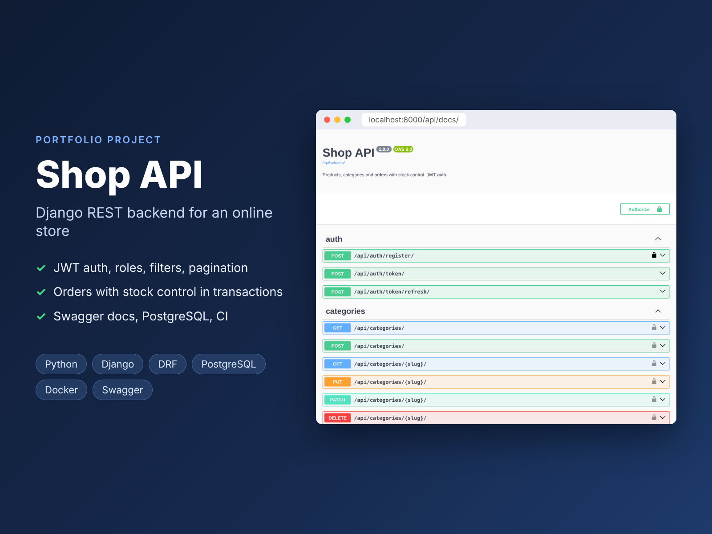

# Shop API: Django REST backend for an online store



A REST API backend for a small online store. It covers the product catalog, user registration with JWT, and orders with stock control and a status workflow. It comes with auto-generated Swagger docs, PostgreSQL, Docker and CI.

> Portfolio project. It is covered by API tests that run in CI against PostgreSQL.

**Stack:** Python 3.12 · Django · Django REST Framework · SimpleJWT · django-filter · drf-spectacular (OpenAPI/Swagger) · PostgreSQL · Docker Compose · gunicorn · GitHub Actions

## Features

- **Auth:** registration with password validation, JWT access/refresh tokens
- **Catalog:** categories and products; anyone can read them, only staff can edit. Hidden (inactive) products are visible to staff only
- **Filtering, search, sorting, pagination:** `?category=phones&price_min=10&price_max=500&in_stock=true&search=pro&ordering=-price`
- **Orders:**
  - Creating an order checks stock and decreases it **in one transaction with row locking** (`select_for_update`), so two buyers can't buy the last item at the same time
  - Duplicate lines in a request are merged. If any item is out of stock, nothing is saved
  - The price is fixed at order time, so later price changes don't affect old orders
  - Status workflow `new → paid → shipped`, plus cancellation. Invalid transitions are rejected, and cancellation returns items to stock
  - Buyers see and cancel only their own orders. Staff see all orders and change statuses
- Rate limiting (throttling), Django admin with inline order items, and a `seed_demo` command for demo data

## Endpoints

| Method | URL | Who |
|---|---|---|
| POST | `/api/auth/register/` | anyone |
| POST | `/api/auth/token/`, `/api/auth/token/refresh/` | anyone |
| GET | `/api/categories/`, `/api/products/` | anyone |
| POST/PUT/PATCH/DELETE | `/api/categories/…`, `/api/products/…` | staff |
| GET/POST | `/api/orders/` | authenticated (own orders) |
| POST | `/api/orders/{id}/cancel/` | order owner |
| POST | `/api/orders/{id}/set_status/` | staff |

Interactive docs are at **`/api/docs/`** (Swagger UI), and the OpenAPI schema is at `/api/schema/`.

## Quick start (Docker)

```bash
cp .env.example .env
docker compose up -d --build
docker compose exec web python manage.py seed_demo   # demo users: admin/admin12345, buyer/buyer12345
```

Then open http://localhost:8000/api/docs/

## Local run (SQLite)

```bash
python -m venv .venv && source .venv/bin/activate
pip install -r requirements-dev.txt
python manage.py migrate && python manage.py seed_demo
python manage.py runserver
```

## Example

```bash
TOKEN=$(curl -s -X POST localhost:8000/api/auth/token/ \
  -d username=buyer -d password=buyer12345 | jq -r .access)

curl -X POST localhost:8000/api/orders/ \
  -H "Authorization: Bearer $TOKEN" -H "Content-Type: application/json" \
  -d '{"address": "Karakol, Toktogul 1", "items": [{"product_id": 1, "quantity": 2}]}'
```

## Tests

```bash
python manage.py test
ruff check .
```

16 API tests cover auth, permissions, filters, stock decrease and rollback, price fixation, order visibility, cancellation and the status workflow.

## Project structure

```
config/          # settings (from environment), urls
shop/
├── models.py       # Category, Product, Order, OrderItem
├── services.py     # order logic: transactions, stock, status transitions
├── api.py          # viewsets
├── serializers.py
├── filters.py, permissions.py, admin.py
├── management/commands/seed_demo.py
└── tests/
```
